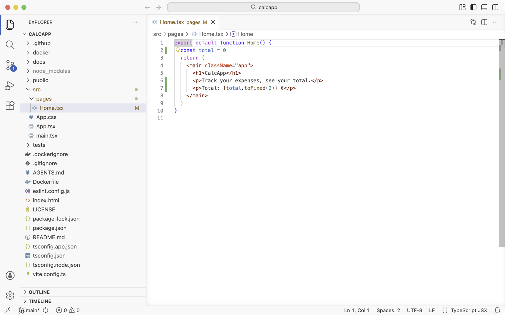
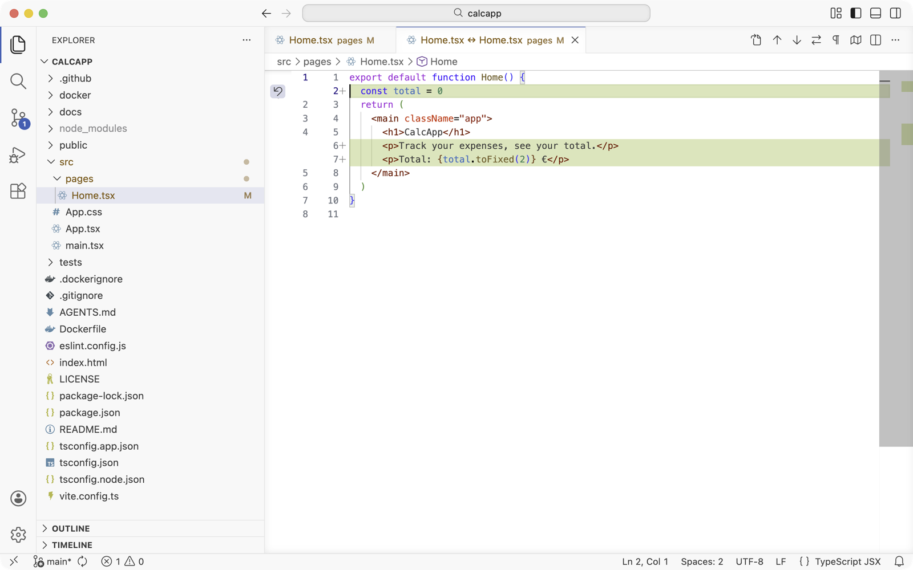
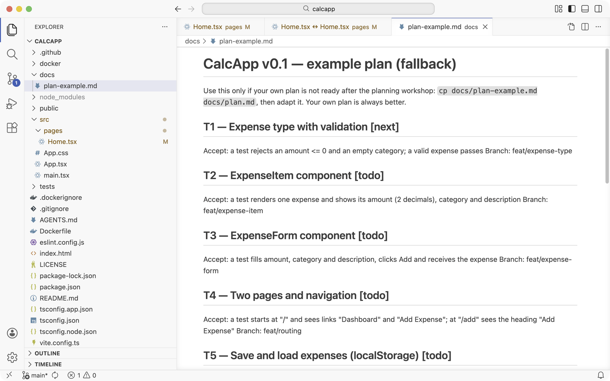

# An editor next to opencode — VSCodium mini guide

*Content licensed CC BY 4.0.*

**In one sentence:** opencode changes your project; the editor is for **reading** it.
The course editor is **VSCodium** — in the course VM it is **VS Code**, already installed, its AI
already off. Install it on day 1 if time allows, at the latest on day 2 morning: it makes the code,
the changes and the documents much easier to read.

## 1. Which editor, and the one rule

The course uses **[VSCodium](https://vscodium.com)**: the open-source build of VS Code, free, with
no Copilot account and no Microsoft telemetry. In the course VM, **VS Code** plays this role: it is
already installed and its AI is already off (same setting as below).

> **Rule during the workshops: the editor's AI stays off; only opencode writes to the project.**

Why:

- two agents writing in the same folder overwrite each other's work;
- the editor's agent also reads `AGENTS.md` and the GSE-One files and may act on them;
- AI completion writes the code — or the test — in your place: on day 2 the test is yours;
- agent extensions (Cline, Continue, Kilo Code, …) bring a second agent back: do not install them.

## 2. Install

| System | Command |
|---|---|
| Windows (also with WSL: install the Windows build, open your WSL files through `\\wsl$`) | `winget install VSCodium.VSCodium` |
| Ubuntu | `sudo snap install codium --classic` |
| Other Linux | `flatpak install flathub com.vscodium.codium` (install flatpak first) |
| macOS | `brew install --cask vscodium` |

Then, once: **Settings** (Windows/Linux `Ctrl+,`, macOS `Cmd+,`) → search **`disable AI features`**
→ tick it. In `settings.json` this is `"chat.disableAIFeatures": true` (checked in VSCodium 1.112).

### Open your project in the editor

On macOS or Ubuntu, from the project folder (CalcApp here):

```bash
cd ~/ai4se/calcapp
```

```bash
codium .
```

In the course VM (VS Code):

```bash
code .
```

On Windows: open VSCodium from the Start menu, then **File → Open Folder…**; with WSL, the project
is at `\\wsl$\Ubuntu\home\` + your Linux user name + `\ai4se\calcapp`.

Without a terminal, on any system: **File → Open Folder…** → `~/ai4se/calcapp` (or your mini-project).

### Extensions for CalcApp (optional, ~2 min)

Five extensions make CalcApp easier to read. None has AI; all come from Open VSX, VSCodium's catalogue.
TypeScript, JavaScript, Markdown preview and the git diff view are already built in.

| Extension | What you get |
|---|---|
| ESLint (`dbaeumer.vscode-eslint`) | the lint problems of `npm run lint`, underlined in the code |
| Vitest (`vitest.explorer`) | the tests in a side panel: see which pass, open the failing one |
| Git Graph (`mhutchie.git-graph`) | branches, commits and tags as a graph (day 2 git, recovery tags, GSE-One branches) |
| YAML (`redhat.vscode-yaml`) | readable `.gse/*.yaml` files and CI workflows |
| Error Lens (`usernamehw.errorlens`) | TypeScript errors written at the end of the faulty line |

All five in one line (macOS or Ubuntu, VSCodium):

```bash
for e in dbaeumer.vscode-eslint vitest.explorer mhutchie.git-graph redhat.vscode-yaml usernamehw.errorlens; do codium --install-extension "$e"; done
```

In the course VM, the same line with `code` instead of `codium` (or `codium` if you installed VSCodium there).

Or one command at a time (macOS or Ubuntu, VSCodium). On Windows, or without a terminal:
**Extensions** panel (`Ctrl+Shift+X`, macOS `Cmd+Shift+X`) → type the name → **Install**.


```bash
codium --install-extension dbaeumer.vscode-eslint
```

```bash
codium --install-extension vitest.explorer
```

```bash
codium --install-extension mhutchie.git-graph
```

```bash
codium --install-extension redhat.vscode-yaml
```

```bash
codium --install-extension usernamehw.errorlens
```

In the course VM (VS Code), the same with `code`:

```bash
code --install-extension dbaeumer.vscode-eslint
```

```bash
code --install-extension vitest.explorer
```

```bash
code --install-extension mhutchie.git-graph
```

```bash
code --install-extension redhat.vscode-yaml
```

```bash
code --install-extension usernamehw.errorlens
```

Check what is installed:

```bash
codium --list-extensions
```

Then, once: **Settings** → search **`redhat.telemetry`** → untick it (the YAML extension asks to send usage data).

**Do not install:** any AI extension (Copilot, Continue, Cline, Kilo Code, Codeium, Tabnine, …) — see § 1;
GitLens (it brings AI features); a formatter that rewrites files on save (Prettier « format on save »):
CalcApp has no formatter, and rewriting the agent's files would hide its real changes in the diff.

## 3. Read the code



The **Explorer** (left) shows the project tree. A file changed since the last commit is marked
**M** (modified) or **U** (new, untracked); the coloured bar in the margin marks changed lines.
Click a file to read it.

## 4. See what the agent changed



After opencode works, open **Source Control** (`Ctrl+Shift+G`, the branch icon with a number on
the left bar) and click a changed file: the editor shows the old and the new version, added lines
in green, removed lines in red. This is how you check the agent's work before you accept it — the
review habit of day 2.

Commits, branches and merges stay with opencode and GSE-One: **do not use the editor's
Commit or Sync buttons** — GSE-One records its own state with each commit.

## 5. Read the documents



Plans, requirements and reviews are Markdown files (`docs/plan.md`, and from day 3 the files
under `docs/sprints/` such as `reqs.md` or `review.md`). Open one and press
`Cmd+Shift+V` (macOS) or `Ctrl+Shift+V` to see it formatted; right-click the tab → *Open Preview
to the Side* to keep source and preview side by side.

## 6. Fix one line yourself

You may correct a typo by hand: edit, **save** (`Cmd+S` / `Ctrl+S`), then tell opencode what you
changed so it does not undo it. Anything bigger: ask opencode.

## 7. You already use another editor

- **VS Code:** fine — same setting, `"chat.disableAIFeatures": true`; sign out of Copilot.
- **Cursor:** not during the workshops — its agent is the editor itself.
- **Any other editor:** turn its AI assistant and completion off for the course days.
